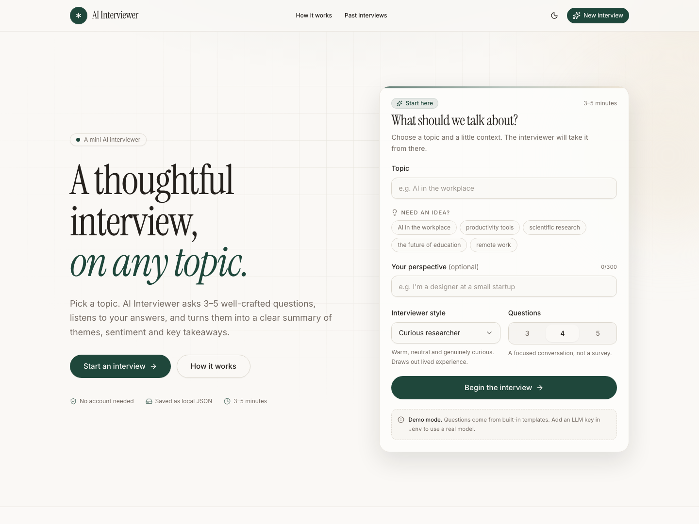
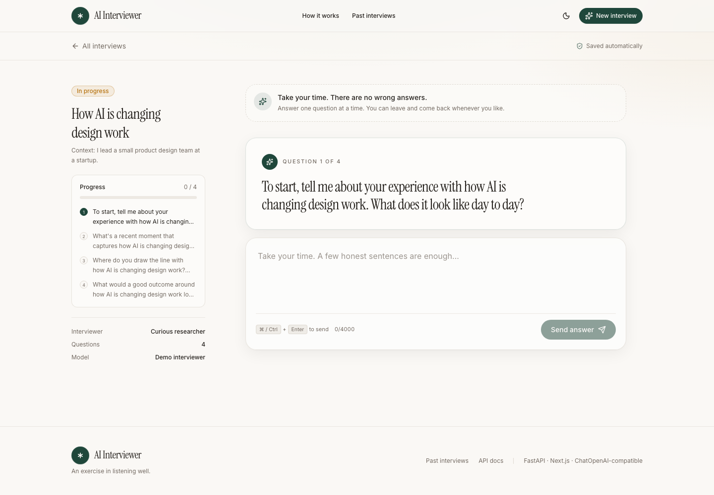
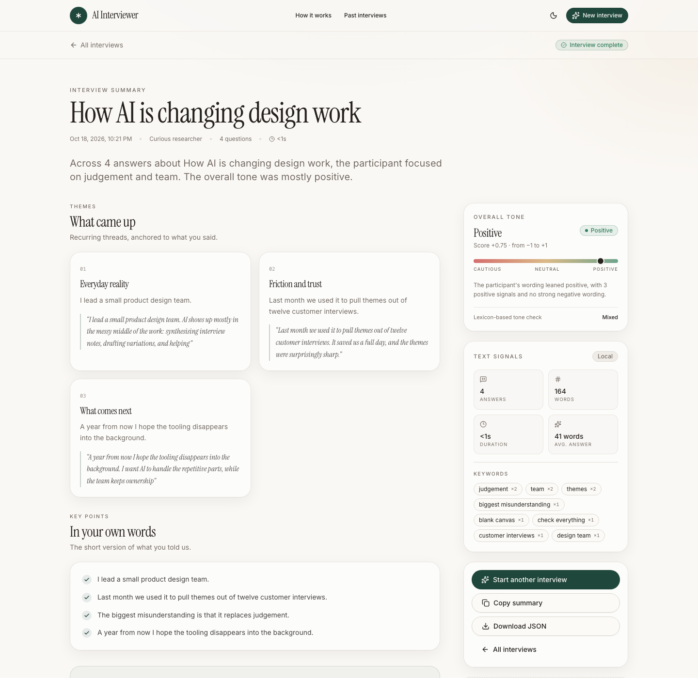
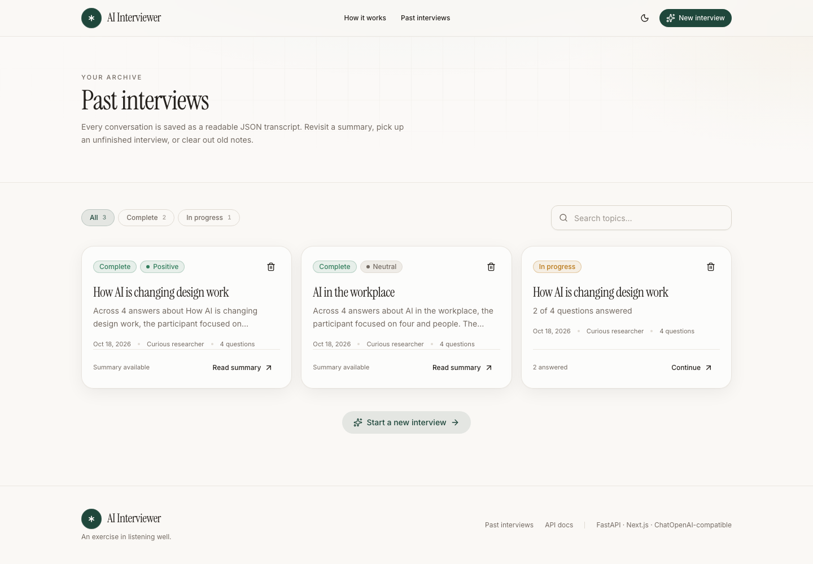
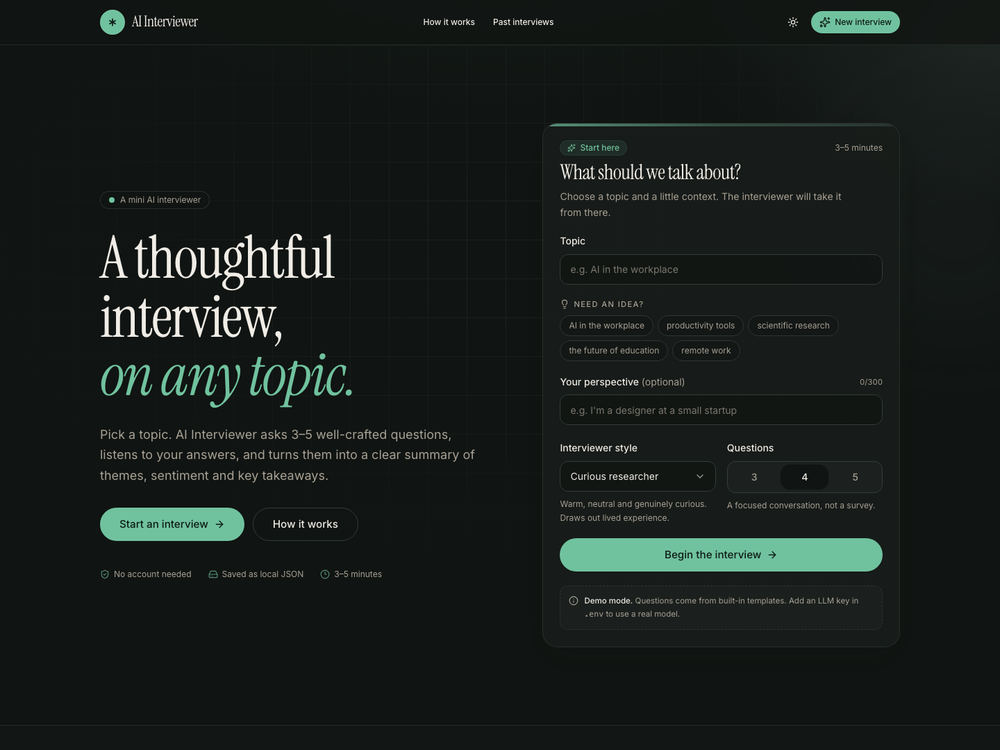

# AI Interviewer

**A mini AI interviewer built as a technical assignment.** A small, polished take on the [Anthropic Interviewer](https://www.anthropic.com/news/anthropic-interviewer) idea: pick a topic, answer 3–5 AI-generated questions, and get a grounded summary of themes, sentiment and key points.

The stack is deliberately boring in the best way: **FastAPI** for a layered backend, **Next.js (JavaScript)** for the interface, **ChatOpenAI** for provider-agnostic model access, and **Docker Compose** to run everything. It works with **no API key** in demo mode and switches to a real model with a couple of `.env` lines.



## What it does

- Start an interview on any topic, with an optional bit of personal context and a choice of interviewer persona.
- The LLM generates a **3–5 question plan** with a deliberate arc: lived experience → reflection → outlook.
- Answer **one question at a time** in a chat-like interface, with progress saved after every answer.
- When the last answer is in, the LLM writes a **faithful summary** with themes, a sentiment score, key points and verbatim quotes.
- The transcript and summary are stored as **readable JSON** on disk.
- Bonus analysis runs locally: **VADER sentiment** and **keyword extraction**, plus word/duration stats.
- Browse past interviews, continue unfinished ones, download JSON, copy a summary, delete interviews, and switch between light and dark themes.

| Interview | Summary |
| --- | --- |
|  |  |

<br />

| Archive | Dark mode |
| --- | --- |
|  |  |

## Quick start (Docker)

```bash
cp .env.example .env
docker compose up --build
```

- App: **http://localhost:3000**
- API docs: **http://localhost:8000/docs** (also proxied at **http://localhost:3000/docs**)
- API health: **http://localhost:8000/api/v1/health**

No key is required on the first run: `LLM_PROVIDER=mock` uses a transparent built-in demo interviewer. The UI and `/api/v1/meta` label this as demo mode; the full product flow still works.

Data lives in the `ai_interviewer_data` Docker volume, so `docker compose down` keeps your interviews. Use `docker compose down -v` to remove them.

### Use a real model

Open `.env`, replace `LLM_PROVIDER=mock` with a provider block, and recreate the API container:

```bash
# OpenAI
LLM_PROVIDER=openai
LLM_MODEL=gpt-4o-mini
LLM_API_KEY=sk-...

docker compose up -d
```

Every hosted provider below speaks the OpenAI chat-completions protocol, so the same `langchain_openai.ChatOpenAI` adapter handles them all:

| Provider | `LLM_PROVIDER` | Example `LLM_MODEL` | Notes |
| --- | --- | --- | --- |
| OpenAI | `openai` | `gpt-4o-mini` | Requires `LLM_API_KEY` |
| OpenRouter | `openrouter` | `openai/gpt-4o-mini` | Requires a key |
| Groq | `groq` | `llama-3.3-70b-versatile` | Requires a key |
| DeepSeek | `deepseek` | `deepseek-chat` | Requires a key |
| Mistral | `mistral` | `mistral-small-latest` | Requires a key |
| Together AI | `together` | `meta-llama/Llama-3.3-70B-Instruct-Turbo` | Requires a key |
| Ollama | `ollama` | `llama3.2` | Local; no key |
| LM Studio | `lmstudio` | your loaded model | Local; no key |
| vLLM | `vllm` | your served model | Local; no key |
| Any compatible API | `custom` | your model | Set `LLM_BASE_URL` |

Local model examples:

```bash
# Ollama running on the host, with Docker Desktop
LLM_PROVIDER=ollama
LLM_MODEL=llama3.2
LLM_BASE_URL=http://host.docker.internal:11434/v1

# Or use the bundled optional Ollama container:
#   docker compose --profile local-llm up -d
#   docker compose exec ollama ollama pull llama3.2
LLM_PROVIDER=ollama
LLM_MODEL=llama3.2
LLM_BASE_URL=http://ollama:11434/v1
```

Any OpenAI-compatible gateway works through `custom` — including LiteLLM, llama.cpp and self-hosted servers. For native Anthropic or Gemini APIs, point `custom` at an OpenAI-compatible gateway (for example LiteLLM or OpenRouter).

### Tune the interview

`LLM_TEMPERATURE`, `LLM_MAX_TOKENS`, the question count bounds, answer length, interviewer language, personas and analysis settings are all in `.env`. The full list is documented inline in [`.env.example`](.env.example).

## Architecture

AI Interviewer uses a layered (hexagonal-style) architecture. Dependencies point inward: the domain knows nothing about HTTP, LangChain or the filesystem.

```text
┌──────────────────────────────────────────────────────────────┐
│ Browser                                                      │
│ Next.js App Router (JavaScript) + shadcn-style UI            │
│ client → /backend/* → Next rewrite (same-origin proxy)       │
└───────────────────────────┬──────────────────────────────────┘
                            │ HTTP / JSON
┌───────────────────────────▼──────────────────────────────────┐
│ API layer                    backend/app/api                │
│ routers · request/response schemas · presenters · errors     │
└───────────────────────────┬──────────────────────────────────┘
                            │
┌───────────────────────────▼──────────────────────────────────┐
│ Application layer            backend/app/application         │
│ InterviewService · InterviewPolicy · prompt builder          │
└──────────┬───────────────────────────────────┬───────────────┘
           │ implements ports                  │ implements ports
┌──────────▼───────────────┐      ┌────────────▼───────────────┐
│ Domain                   │      │ Infrastructure            │
│ entities · values        │◄─────┤ LLM · repositories ·      │
│ errors · ports           │      │ local analysis            │
└──────────────────────────┘      └────────────────────────────┘
```

| Layer | Location | Responsibility |
| --- | --- | --- |
| Domain | `backend/app/domain` | `Interview` aggregate, questions/answers/summary values, invariants, and the ports (protocols) that adapters implement. No framework imports. |
| Application | `backend/app/application` | `InterviewService` use cases, `InterviewPolicy` validation, and the interview/summary prompts. Depends only on domain ports. |
| Infrastructure | `backend/app/infrastructure` | `ChatOpenAI` adapter + provider presets, JSON and in-memory repositories, VADER/keyword analysis, mock interviewer. |
| API | `backend/app/api` | FastAPI routes, HTTP schemas, presenters, error mapping, dependencies. |
| Shared core | `backend/app/core` | Environment-driven settings and interviewer personas. |
| Frontend | `frontend/` | Next.js App Router, JavaScript/JSX only, accessible shadcn-style components and API client. |

Object-oriented design is used where it earns its keep: the `Interview` entity owns state transitions and validations, the service depends on abstract ports, and each adapter (LLM, storage, analysis) is a swappable class.

### Backend structure

```text
backend/
├── app/
│   ├── api/
│   │   ├── routes/             # system.py (health/meta), interviews.py
│   │   ├── presenters.py       # domain → API DTOs
│   │   ├── errors.py           # consistent JSON error envelope
│   │   └── dependencies.py
│   ├── application/
│   │   ├── interview_service.py
│   │   ├── policy.py
│   │   └── prompts.py
│   ├── core/
│   │   ├── config.py           # all env-driven settings
│   │   └── personas.py
│   ├── domain/
│   │   ├── entities.py         # Interview, Question, Answer, Summary, Analysis
│   │   ├── values.py           # drafts + agent info
│   │   ├── ports.py            # repository / agent / analyzer protocols
│   │   └── errors.py
│   ├── infrastructure/
│   │   ├── llm/                # presets, ChatOpenAI client, agent, mock, factory
│   │   ├── repositories/       # JSON files, in-memory
│   │   └── analysis/           # VADER + keyword extraction
│   ├── schemas/                # API request/response models
│   └── main.py                 # app factory + ASGI entry point
├── tests/
├── Dockerfile
└── requirements*.txt
```

## How an interview flows

1. **Plan** — `POST /api/v1/interviews` validates the topic/context/count/persona, calls the interviewer agent once, and stores a 3–5 question plan.
2. **Answer** — `POST /api/v1/interviews/{id}/answers` saves one answer at a time. Answers can be revised until the interview is completed.
3. **Complete** — `POST /api/v1/interviews/{id}/complete` checks that all questions are answered, asks the model for a structured summary, runs local analysis, and marks the interview complete. Calling it twice returns the stored result (idempotent).
4. **Read** — summaries and transcripts are returned by `GET /api/v1/interviews/{id}` and can be downloaded from `/export`.

```bash
# Start an interview
curl -s -X POST http://localhost:8000/api/v1/interviews \
  -H 'Content-Type: application/json' \
  -d '{"topic":"AI in the workplace","question_count":4,"context":"I am a designer"}'

# Answer a question (question_id comes from the response above)
curl -s -X POST http://localhost:8000/api/v1/interviews/<id>/answers \
  -H 'Content-Type: application/json' \
  -d '{"question_id":"<question_id>","answer":"It saves me time on first drafts."}'

# Generate the summary
curl -s -X POST http://localhost:8000/api/v1/interviews/<id>/complete
```

### API

| Method | Path | Purpose |
| --- | --- | --- |
| `GET` | `/api/v1/health` | Liveness + provider readiness |
| `GET` | `/api/v1/meta` | Limits, personas, topics, model status for the UI |
| `POST` | `/api/v1/interviews` | Start an interview and generate its question plan |
| `GET` | `/api/v1/interviews` | List recent interviews (`limit`, `offset`) |
| `GET` | `/api/v1/interviews/{id}` | Load an interview (in progress or completed) |
| `POST` | `/api/v1/interviews/{id}/answers` | Save or revise an answer |
| `POST` | `/api/v1/interviews/{id}/complete` | Generate summary + analysis and complete |
| `GET` | `/api/v1/interviews/{id}/export` | Download the stored JSON with an attachment filename |
| `DELETE` | `/api/v1/interviews/{id}` | Delete an interview |

Errors use one envelope:

```json
{
  "error": {
    "code": "interview_incomplete",
    "message": "Answer every question before generating the summary.",
    "details": { "remaining": 2 }
  }
}
```

### Storage

One JSON file per interview under `DATA_DIR/interviews/<id>.json`. Writes are atomic (temp file + `os.replace`) and file I/O runs off the event loop. The file includes the topic, question plan, every answer, the summary, analysis and provider metadata:

```json
{
  "id": "390372fe...",
  "topic": "How AI is changing design work",
  "status": "completed",
  "questions": [{ "index": 0, "text": "...", "intent": "..." }],
  "answers": [{ "question_id": "...", "text": "...", "answered_at": "..." }],
  "summary": {
    "overview": "...",
    "themes": [{ "title": "Everyday leverage", "insight": "...", "quote": "..." }],
    "sentiment": { "label": "positive", "score": 0.75, "explanation": "..." },
    "key_points": ["..."],
    "notable_quote": "..."
  },
  "analysis": { "keywords": ["..."], "stats": { "word_count": 164 } }
}
```

`STORAGE_BACKEND=memory` is available for ephemeral demos and tests. The repository port makes a database adapter a drop-in addition.

## Prompt design and LLM interaction

Prompts live in `backend/app/application/prompts.py`, separately from the provider adapter.

**Question plan**

- Assigns the model the role of a qualitative interviewer.
- Enforces craft rules: open-ended, one idea per question, no leading questions, concrete experiences, an arc from lived experience to outlook, under 35 words.
- Applies the chosen persona's tone.
- Treats the topic and participant context as **data inside a JSON block**, and explicitly tells the model to ignore instructions inside it.
- Requests a strict JSON contract: `{"questions":[{"text":"...","intent":"..."}]}`.

**Summary**

- Instructs a qualitative analyst to stay grounded, never invent facts or opinions, and say when the participant was ambiguous.
- Requests 2–4 themes with a title, insight and **verbatim** quote; 3–5 key points; a sentiment label, score between −1 and 1, and a one-sentence explanation; and a notable quote.
- The adapter **checks every returned quote against the transcript** (`clean_quote`); anything that is not a real substring is dropped rather than shown as if it were said.
- The user transcript is passed as JSON inside `<transcript_json>` and treated as data, not instructions.

**Robustness**

- Responses are parsed even when wrapped in markdown fences or surrounded by commentary.
- Invalid JSON or schema violations trigger a short repair turn, up to `LLM_JSON_ATTEMPTS`.
- Provider timeouts/retries are configured with `LLM_TIMEOUT_SECONDS` and `LLM_MAX_RETRIES`.
- A missing/invalid provider configuration does not crash the API: `/health` reports `degraded`, `/meta` explains the problem, and creation returns a clear `503`.
- `LLM_JSON_MODE=true` enables native JSON response mode for providers that support it.

## Bonus analysis

The summary view also includes a local analysis pass (enabled by `ANALYSIS_ENABLED`):

- **Sentiment:** VADER compound score per answer and an overall word-weighted score, with mixed-polarity detection.
- **Keywords:** frequency and bigram extraction with a small English stopword list (`ANALYSIS_KEYWORDS_TOP_N` controls how many).
- **Stats:** answer count, word count, average answer length and interview duration.

This is computed locally, so it adds no LLM cost and still works in demo mode. VADER is lexicon-based and English-oriented; it is a signal, not a verdict.

## Frontend UX

- Next.js App Router in **JavaScript/JSX** (no TypeScript).
- shadcn-style primitives: Button, Card, Input, Textarea, Select, Badge, Progress, Separator, Skeleton, AlertDialog and Sonner toasts, built on Radix UI and Tailwind CSS.
- Custom editorial design: Instrument Serif display type, Inter body, warm parchment palette, light/dark themes via `next-themes`.
- Interview room with chat history, persistent progress, auto-growing answer box, character count, `⌘/Ctrl + Enter` submit, and a staged “finding the signal” transition.
- Summary page with theme cards, grounded quotes, sentiment meter, keyword chips, transcript accordion, copy and JSON download.
- Archive with search, status filters, resume links and a delete confirmation dialog.
- Responsive layouts, keyboard focus states, semantic labels, screen-reader hints, reduced-motion support, and a skip link.

The browser talks to `/backend/*`, which Next rewrites to the API (`http://api:8000` in Compose, `http://localhost:8000` locally). That keeps the app same-origin and avoids CORS configuration in normal use; direct API access is also CORS-enabled through `CORS_ORIGINS`.

## Configuration reference

All settings are environment variables loaded by `pydantic-settings`. See [`.env.example`](.env.example) for the complete annotated list.

| Variable | Default | Description |
| --- | --- | --- |
| `APP_NAME` | `AI Interviewer` | Display name |
| `APP_ENV` | `development` | `development`, `production` or `test` |
| `LOG_LEVEL` | `INFO` | Python log level |
| `API_PREFIX` | `/api/v1` | API route prefix |
| `CORS_ORIGINS` | `http://localhost:3000,...` | Comma-separated allowed origins |
| `INTERVIEW_MIN_QUESTIONS` / `MAX` | `3` / `5` | Bounds enforced by the service |
| `INTERVIEW_DEFAULT_QUESTIONS` | `4` | Preselected count |
| `INTERVIEW_MAX_ANSWER_CHARS` | `4000` | Answer limit |
| `INTERVIEW_LANGUAGE` | `English` | Prompt language |
| `INTERVIEW_DEFAULT_PERSONA` | `curious-researcher` | Default interview style |
| `INTERVIEW_SUGGESTED_TOPICS` | 5 topics | Pipe-separated landing-page suggestions |
| `LLM_PROVIDER` | `mock` | Provider preset (`openai`, `ollama`, `custom`, …) |
| `LLM_MODEL` | preset default | Model name |
| `LLM_API_KEY` | empty | Provider key (not needed for mock/local) |
| `LLM_BASE_URL` | preset default | OpenAI-compatible endpoint override |
| `LLM_TEMPERATURE` | `0.6` | Sampling temperature |
| `LLM_MAX_TOKENS` | `1200` | Completion cap |
| `LLM_TIMEOUT_SECONDS` | `60` | Request timeout |
| `LLM_MAX_RETRIES` | `2` | Client-level retries |
| `LLM_JSON_ATTEMPTS` | `2` | JSON repair attempts |
| `LLM_JSON_MODE` | `false` | Use native JSON response mode |
| `STORAGE_BACKEND` | `json` | `json` or `memory` |
| `DATA_DIR` | `./data` | JSON storage location (`/data` in Docker) |
| `ANALYSIS_ENABLED` | `true` | Toggle the bonus analysis |
| `ANALYSIS_KEYWORDS_TOP_N` | `8` | Number of keywords to show |
| `API_PORT` / `WEB_PORT` | `8000` / `3000` | Compose host ports |
| `OLLAMA_PORT` | `11434` | Optional Ollama profile port |

## Local development (without Docker)

```bash
cp .env.example .env

# Terminal 1 — API
cd backend
python3 -m venv .venv
.venv/bin/pip install -r requirements-dev.txt
.venv/bin/uvicorn app.main:app --reload --port 8000

# Terminal 2 — web
cd frontend
npm install
npm run dev
```

The frontend defaults to `BACKEND_INTERNAL_URL=http://localhost:8000`; override it in `frontend/.env.local` if needed.

Or use the Makefile:

```bash
make install   # creates the venv, installs backend + frontend deps, creates .env
make api       # FastAPI on :8000
make web       # Next.js on :3000
make test      # backend tests
make lint      # frontend ESLint
make build     # production Next.js build
```

## Tests and verification

```bash
cd backend && .venv/bin/python -m pytest      # 19 tests
cd frontend && npm run lint && npm run build  # ESLint clean, production build
```

Backend tests cover the full HTTP lifecycle (create → answer → complete → list → export → delete), question/persona/answer validation, early completion, idempotent completion, unknown IDs, provider misconfiguration, prompt-injection framing, quote grounding, JSON extraction, provider presets, keyword/sentiment analysis, JSON repository roundtrip and memory storage.

The Docker images were built and the Compose stack was run end-to-end, including the Next.js proxy, `/api/v1/health`, persisted interviews in the named volume, and the browser flow in both light and dark modes. Screenshots in `docs/screens` were captured with Playwright against the running stack.

## Design decisions and trade-offs

- **JSON over a database.** The assignment explicitly allows JSON, and readable files make the result easy to inspect. The repository port keeps a SQLite/Postgres adapter straightforward.
- **One question plan, then answers.** The plan is generated up front so the interview length is predictable and the UX stays fast. Adaptive follow-up questions would be a natural next step: generate the next question from prior answers.
- **Transparent demo mode.** With no key, `LLM_PROVIDER=mock` produces deterministic questions and a grounded extractive summary. The API and UI clearly mark it as a demo; it never claims to be an LLM.
- **Quote grounding.** The summary prompt asks for verbatim quotes, and the adapter verifies them. It is a small addition that prevents the most visible kind of hallucination.
- **Provider breadth via ChatOpenAI.** The OpenAI protocol is the widest common denominator for hosted and local models, and it is one dependency instead of one adapter per vendor. Native-vendor adapters can implement the same `InterviewerAgent` port.
- **In-process locking, single worker.** Answer/completion writes are serialized per interview in the API process. For multiple workers or a distributed deployment, use a database with optimistic concurrency or a lock service.
- **No auth or rate limiting.** This is a single-user, local-first tool. Put it behind an authenticating proxy and add per-user limits before exposing it publicly.
- **Privacy.** Transcripts go to whichever LLM provider you configure. The JSON files are plain text in the data volume; treat them as sensitive.

## Assignment checklist

| Requirement | Where |
| --- | --- |
| Start an interview on a chosen topic | Landing form + `POST /api/v1/interviews` |
| Generate 3–5 sequential AI questions | `InterviewPromptBuilder.question_plan` + provider adapter |
| Collect answers interactively | `/interview/[id]` UI, one question at a time, autosaved |
| Produce a brief AI summary | `InterviewPromptBuilder.summary` + `POST /complete` |
| Store transcript and summary | `JsonInterviewRepository` → readable JSON per interview |
| Bonus: sentiment + keywords | `LexicalInterviewAnalyzer` (VADER + frequency/bigram keywords) |
| Code clarity and structure | Domain/application/infrastructure/API layers, typed boundaries, tests |
| Prompt design and LLM interaction | Structured contracts, injection framing, JSON repair, quote verification |
| User experience | Responsive shadcn-style UI, dark mode, progress, toasts, transcript download |

## Limitations and next steps

- Add **adaptive follow-up questions** and a per-answer “why?” probe.
- Add **SQLite/Postgres**, migrations and multi-user ownership.
- Stream model output and show token usage/cost per interview.
- Add authentication, rate limiting, PII redaction and retention controls.
- Add export formats (Markdown, PDF) and cross-interview theme comparison.
- Add automated end-to-end tests (Playwright) and visual regression checks.

---

Built as a technical assignment. The interesting part is not the CRUD; it is designing a short conversation that feels worth answering, and a summary that stays honest to what was said.
